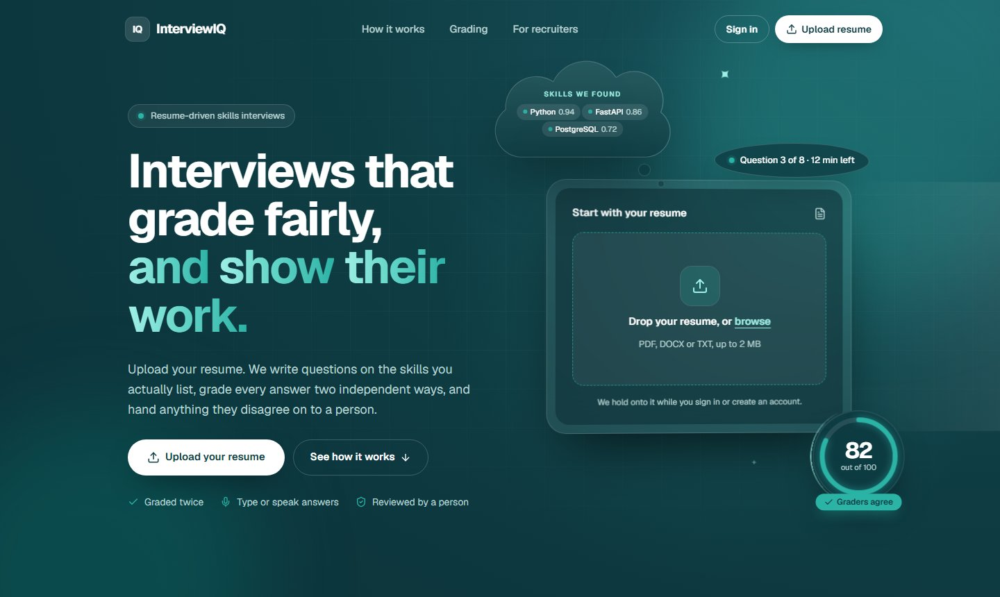
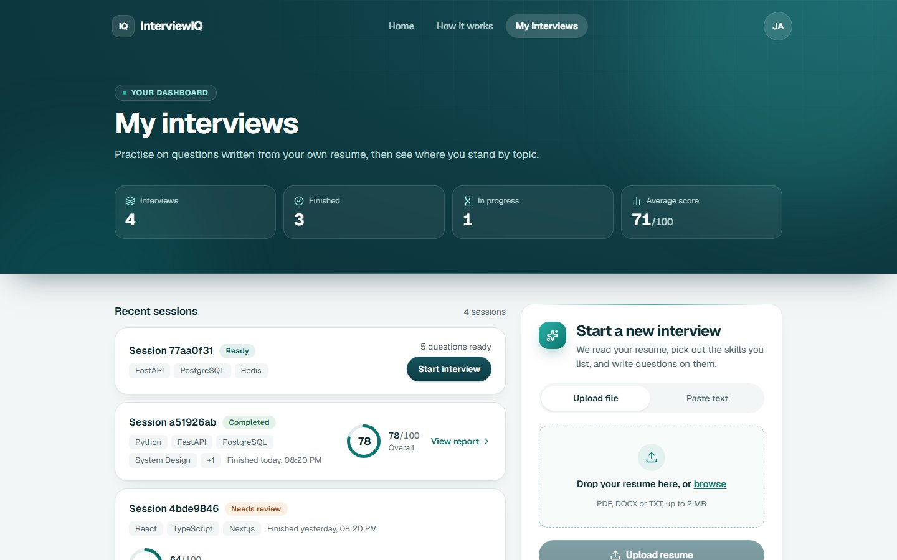
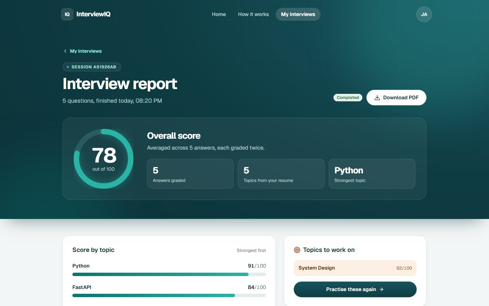
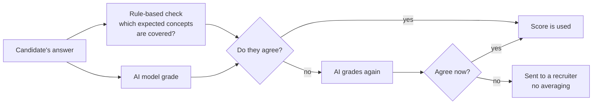
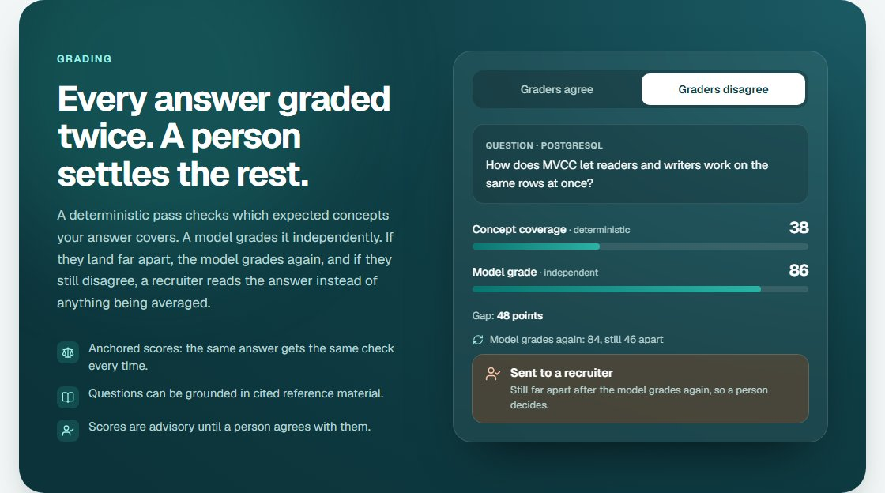
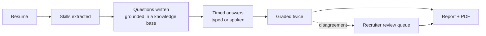
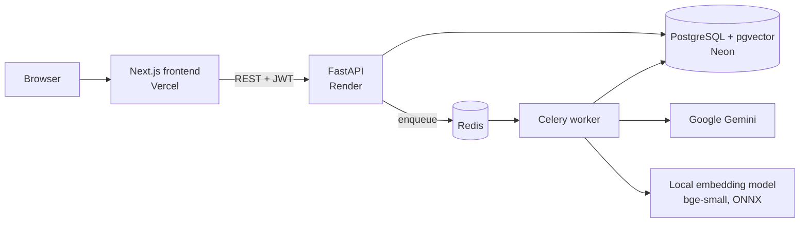

# InterviewIQ

**AI-powered technical interviews that grade fairly and show their work.**

A candidate uploads a résumé and answers interview questions written from the skills on
it. Every answer is graded twice, by a repeatable rule-based check and by an AI model,
and when the two disagree, a recruiter decides instead of the system guessing.

**[▶ Try the live demo](https://interview-iq-blush-phi.vercel.app/)** &nbsp;·&nbsp;
[How it works](#how-it-works) &nbsp;·&nbsp; [Architecture](#architecture) &nbsp;·&nbsp;
[Engineering highlights](#engineering-highlights)

[](https://github.com/EshaAam/InterviewIQ/actions/workflows/ci.yml)




> **Trying the demo:** sign up with any email to use it as a candidate. The backend runs on
> a free tier that sleeps when idle, so the first request after a quiet spell can take
> about a minute.

---

## What it does

**For candidates**

- Upload a résumé (PDF, DOCX or text). The skills it lists are extracted, each with a
  confidence score.
- Answer a timed set of questions written for *those* skills, not a generic question bank.
  Paste a job description and the questions target what the résumé doesn't already cover.
- Get a report: an overall score, scores by topic, strengths, gaps, and a downloadable PDF.

**For recruiters**

- See every interview and open any session to read the answers.
- Work through a **review queue** that holds only the answers the two graders disagreed
  on, and set the final score with a note.
- See advisory **integrity signals** (pasted or unusually fast answers) and a **cost
  ledger** of every AI call.

| Candidate dashboard | Interview report |
|---|---|
|  |  |

---

## The idea behind it

An AI grader can give the same answer a different score each time, which makes it hard to
trust on its own. InterviewIQ never relies on one opinion:



The concepts a good answer should cover are fixed **when the question is written**, before
anyone answers it, so the rule-based check is the same every time. Scores stay advisory
until a person agrees with them.



---

## How it works



1. **Read the résumé.** The AI extracts the candidate's skills and how strongly the résumé
   supports each one.
2. **Write the questions.** Questions are generated per skill and, where possible,
   grounded in a curated knowledge base (retrieval-augmented generation), so a recruiter
   can check each question against the source it came from.
3. **Run the interview.** The server owns the clock. Answers are saved the moment they are
   submitted, and voice answers can be transcribed and edited before submitting.
4. **Grade and report.** Every answer goes through both graders. Agreement produces the
   report. Disagreement sends the answer to the recruiter queue.

---

## Architecture



The API never waits on the AI. It saves the request, puts a job on a queue, and answers
straight away. A background worker does the slow work (reading the résumé, writing
questions, grading, building the report) while the browser polls for the result. Every
interview follows a strict **state machine**, and every pipeline step is **idempotent**, so
a job that is retried or delivered twice can never score an answer twice.

| Layer | Technology |
|---|---|
| Frontend | Next.js 16 (App Router), React 19, TypeScript, Tailwind CSS 4, Motion |
| API | FastAPI, Pydantic, SQLAlchemy 2 (async), Alembic, JWT auth |
| Background jobs | Celery on Redis, with retries, backoff and a stale-job reaper |
| Data | PostgreSQL with pgvector for knowledge-base search |
| AI | Google Gemini (structured JSON output), fastembed (bge-small) embeddings, faster-whisper speech-to-text |
| Testing | pytest, Vitest, Playwright, Locust, GitHub Actions CI |
| Hosting | Vercel (frontend), Render (backend), Neon (Postgres) |

---

## Engineering highlights

- **Reliable background pipeline.** Transient AI failures are retried with exponential
  backoff and end in a clear failure message, never a silent hang. A scheduled reaper
  re-queues work lost to a crash or restart, and AI requests have hard timeouts.
- **Resilient AI layer.** Every model call goes through cache → circuit breaker → retry →
  JSON repair, rotates across API keys around rate limits, and falls back to other models
  when one is overloaded.
- **Defensible scoring.** Expected concepts are set before answering, grading runs at
  temperature 0, and an offline evaluation harness measures grader agreement against
  hand-labelled answers (Cohen's κ).
- **Prompt-injection defence.** Candidate text is fenced off as data, scanned for
  injection attempts, and checked on output. A suspected injection goes to a human and is
  never shown to the candidate.
- **Cost control.** Every AI call, including failed and cached ones, is written to a ledger
  that drives a per-user daily token budget and the recruiter's cost page.
- **Runs on a free tier.** The whole backend (API, worker, Redis and an embedding model)
  fits in one 512 MB container. Memory was profiled and tuned to cut the grading peak
  from 559 MB to under 400 MB.
- **Tested end to end.** 380+ backend tests (complete interviews over HTTP, AI outages,
  a worker dying mid-grading), frontend unit tests, Playwright browser tests, and CI that
  runs every migration against real Postgres. Load-tested at 20 concurrent candidates
  with every API endpoint under 80 ms at p95.

---

## Run it locally

Needs Docker. No API key needed: by default the AI is a deterministic fake.

```bash
cp .env.example .env
docker compose up -d --build
docker compose exec api alembic upgrade head

cd frontend
cp .env.local.example .env.local
npm install && npm run dev        # http://localhost:3000
```

To review interviews, create a recruiter account:
`docker compose exec api python -m app.cli create-recruiter you@company.com`.
To use the real model, set `LLM_PROVIDER=gemini` and `GEMINI_API_KEY` in `.env`.

---

## Author

**Ekramul Esham**, [ekramul.esham@gmail.com](mailto:ekramul.esham@gmail.com)
