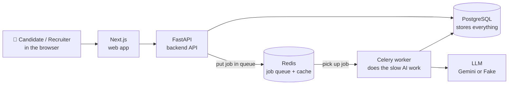
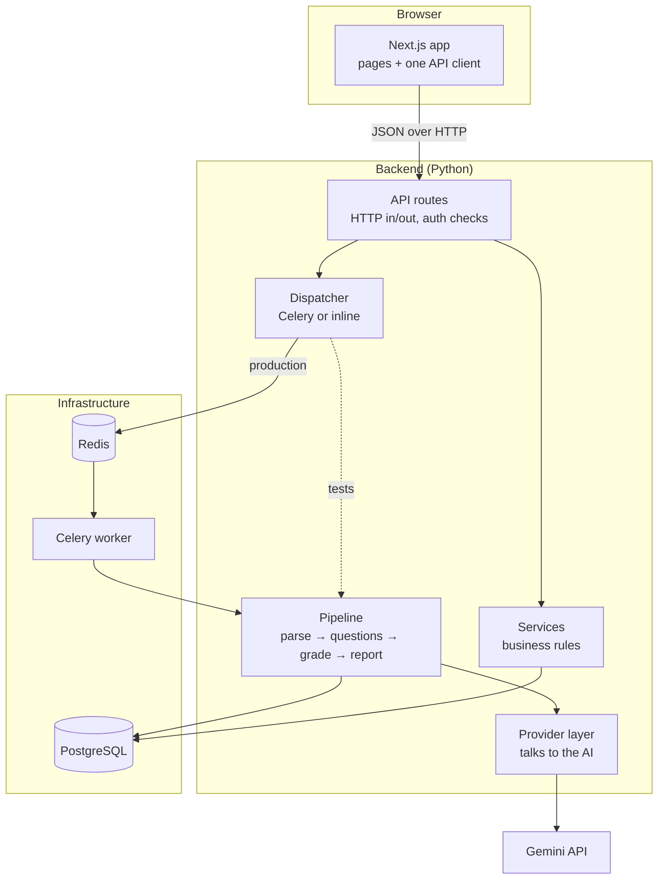
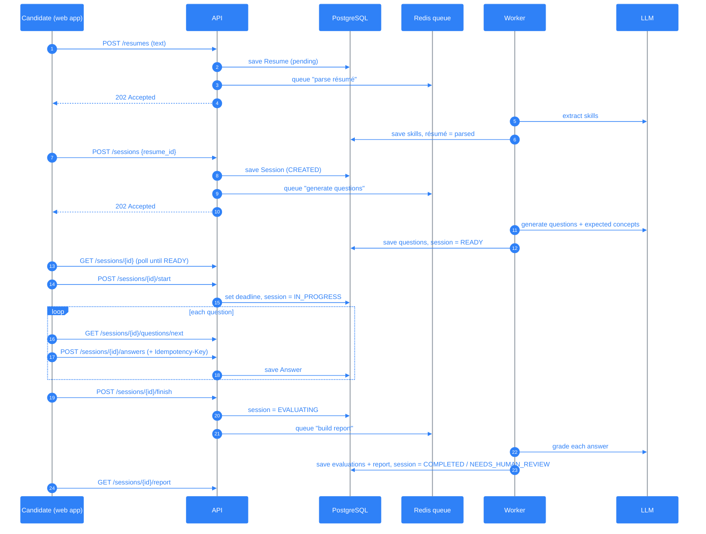
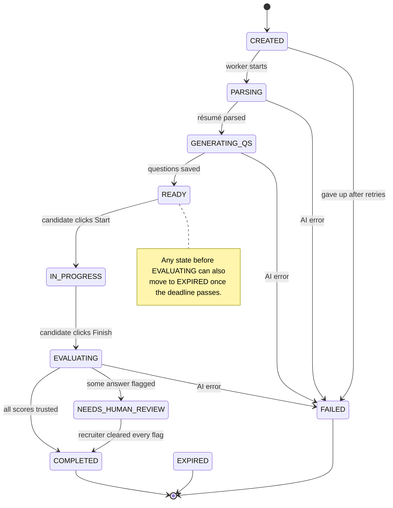
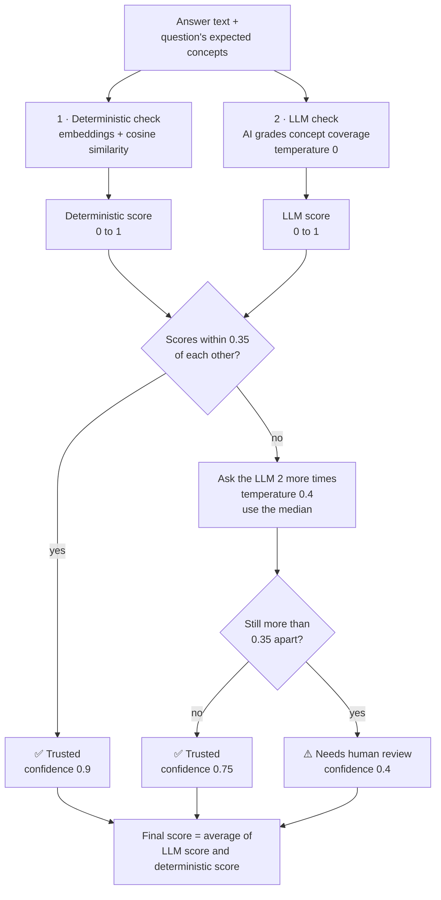
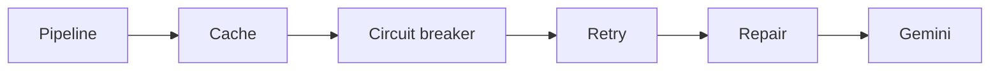
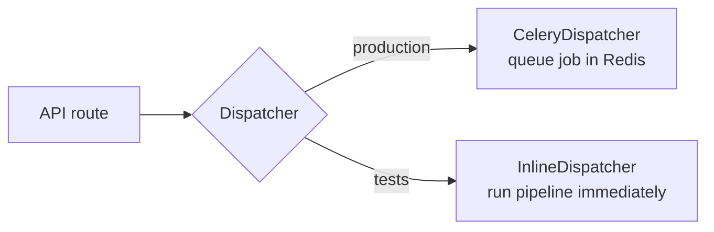
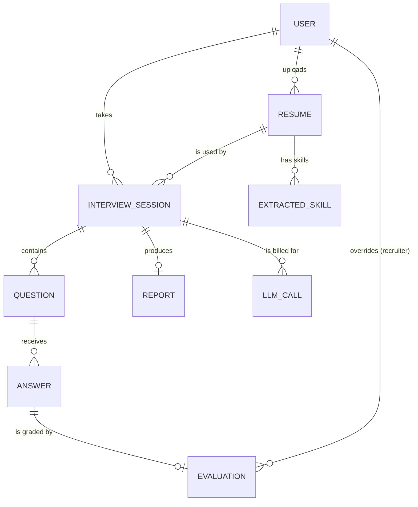

# InterviewIQ: High-Level Design

> **Read this first.** This document explains the whole InterviewIQ project, from
> "what is it?" down to "which file does what". Sections 1-3 give the big picture.
> Sections 4-9 explain each part of the system. Sections 10-14 cover data, the API,
> safety, the code layout and project status. Each section can be read on its own.
>
> *Describes the code as of 2026-09-30.*

---

## Contents

1. [What is InterviewIQ?](#1-what-is-interviewiq)
2. [The big picture in 30 seconds](#2-the-big-picture-in-30-seconds)
3. [Key terms](#3-key-terms)
4. [Technology stack](#4-technology-stack)
5. [System architecture](#5-system-architecture)
6. [An interview from start to finish](#6-an-interview-from-start-to-finish)
7. [The session lifecycle (state machine)](#7-the-session-lifecycle-state-machine)
8. [How answers are scored](#8-how-answers-are-scored)
9. [Talking to the AI: the provider layer](#9-talking-to-the-ai-the-provider-layer)
10. [Background work: Celery workers](#10-background-work-celery-workers)
11. [Data model](#11-data-model)
12. [API overview](#12-api-overview)
13. [Frontend](#13-frontend)
14. [Security, reliability and cost control](#14-security-reliability-and-cost-control)
15. [Where things live in the code](#15-where-things-live-in-the-code)
16. [Running and testing](#16-running-and-testing)
17. [Project status and roadmap](#17-project-status-and-roadmap)

---

## 1. What is InterviewIQ?

InterviewIQ is an **AI-assisted technical interview platform**.

- A **candidate** pastes their résumé. The system reads it, works out their skills, and
  generates interview questions tailored to those skills. The candidate answers the
  questions within a time limit and receives a **report** with an overall score, a
  per-topic score, strengths, and gaps.
- A **recruiter** can see all interview sessions, review answers the AI was unsure
  about, correct scores by hand, and monitor AI usage and cost.

**The core idea.** An AI grader can give a different score each time it grades the
same answer, which makes it unreliable on its own. InterviewIQ grades every answer
**twice**:

1. with a **deterministic** (repeatable, math-based) check, and
2. with the **AI (LLM)**.

When the two grades agree, the score is trusted. When they disagree, the AI tries
again. If they still disagree, the answer is sent to a **human** instead of the
system guessing.

---

## 2. The big picture in 30 seconds



In plain words:

1. The user works in the **web app** (Next.js).
2. The web app calls the **API** (FastAPI) for everything.
3. The API saves data in **PostgreSQL** and replies quickly.
4. Slow work that needs the AI (reading the résumé, writing questions, grading answers)
   is **not** done inside the web request. The API puts a job on a **queue** (Redis),
   and a **worker** (Celery) picks it up and does it in the background.
5. The web app **polls** (asks again every second or two) until the result is ready.

---

## 3. Key terms

| Term | Meaning |
| --- | --- |
| **Session** | One interview attempt by one candidate, based on one résumé. |
| **State** | Where a session is in its life: `READY`, `IN_PROGRESS`, `COMPLETED`, and so on. See [section 7](#7-the-session-lifecycle-state-machine). |
| **Expected concepts** | For each question, the list of ideas a good answer should mention. Created together with the question, *before* anyone answers. |
| **Deterministic score** | A score computed with math (embeddings + similarity). The same input always gives the same score. |
| **LLM score** | A score given by the AI model. It can vary between runs. |
| **Divergence** | When the deterministic score and the LLM score are too far apart (more than 0.35 by default). |
| **Needs review** | An answer flagged for a human recruiter because the two scores kept disagreeing. |
| **Provider** | The code that talks to an AI model. `FakeProvider` is for offline work and tests; `GeminiProvider` calls Google's Gemini. |
| **Worker / task** | A background process (Celery) that runs slow AI work outside the web request. |
| **Dispatcher** | A small layer that decides *how* a background job runs: through Celery in production, or directly in the same process during tests. |
| **Ledger (`llm_calls`)** | A table that records every AI call with its tokens, cost, and success or error. Budgets and cost reports read from it. |
| **Idempotent** | Doing the same thing twice has the same effect as doing it once. Protects against double-clicks and retried jobs. |

---

## 4. Technology stack

| Layer | Technology | Why it's used |
| --- | --- | --- |
| Frontend | Next.js (App Router), React, TypeScript, Tailwind CSS v4 | One web app for both candidates and recruiters. |
| Backend API | FastAPI (Python, async) | Fast, typed HTTP API with automatic docs at `/docs`. |
| Validation | Pydantic v2 | Checks every request and every AI response against a fixed shape. |
| Database | PostgreSQL 16 + SQLAlchemy 2 (async) + Alembic | Main storage. Alembic manages schema changes (migrations). |
| Queue / cache | Redis 7 | Holds background jobs for Celery and caches AI responses. |
| Background jobs | Celery | Runs the slow AI pipeline outside web requests. |
| AI | Google Gemini (`google-genai`) or a built-in FakeProvider | Gemini in real use; the fake provider for offline work and tests. |
| Auth | JWT (PyJWT) + bcrypt | Login tokens and password hashing. |
| Local setup | Docker Compose | Starts the database, Redis, API, worker and scheduler (beat) with one command. |
| Python tooling | uv, pytest, ruff | Dependency management, tests, linting. |

---

## 5. System architecture

### 5.1 Components



### 5.2 What each part is responsible for

| Part | Job | Does NOT do |
| --- | --- | --- |
| **Frontend** | Shows pages, stores login tokens, polls for progress, records typing/paste stats. | Decide scores or deadlines. |
| **API routes** (`app/api/v1/routes`) | Read the request, check login and permissions, call a service, return a response. | Contain business rules or call the AI directly. |
| **Services** (`app/services`) | The rules: which state changes are allowed, budget checks, scoring math, building reports. | Know about HTTP. |
| **Dispatcher** (`app/workers/dispatch.py`) | Sends a job to Celery (production) or runs it right away (tests). | Any business logic. |
| **Pipeline** (`app/services/pipeline.py`) | The four AI steps: parse résumé, generate questions, grade answers, build report. | Commit to the database itself (the caller does). |
| **Provider layer** (`app/providers`) | Hides which AI vendor is used; adds caching, retries and error handling. | Know about sessions or users. |
| **Models** (`app/models`) | Define database tables. | Contain logic. |

**The rule to remember:** *routes validate → services decide → models store.*
Dependencies point one way: `routes → services / dispatcher → pipeline → provider`.

---

## 6. An interview from start to finish

### 6.1 The story

| # | What the candidate does | What happens behind the scenes |
| --- | --- | --- |
| 1 | Registers and logs in. | The API returns two tokens: a short-lived **access token** (15 min) and a **refresh token** (30 days). |
| 2 | Pastes résumé text, or uploads a PDF / DOCX / TXT file. | For a file, the API checks its type from the bytes, extracts the text right away (an unreadable scan gets an immediate "paste instead"), and keeps the original in file storage. Either way a `Resume` row is saved as `pending` and a **parse job** is queued. The worker asks the AI to extract skills (name, confidence, evidence); if that fails the résumé is marked `failed`. |
| 3 | Clicks "Create interview". | An `InterviewSession` is created in state `CREATED`. A **question job** is queued. The worker makes sure the résumé is parsed, then asks the AI for questions. Each question has a topic, a difficulty, and its **expected concepts**. The session becomes `READY`. |
| 4 | Clicks "Start". | The server sets a **deadline** (`expires_at`, 60 minutes by default) and the session becomes `IN_PROGRESS`. |
| 5 | Answers questions one by one. | Each answer is saved with an **Idempotency-Key**, so a double-submit is stored only once. Typing time, paste count and keystrokes are recorded too. |
| 6 | Clicks "Finish". | The session becomes `EVALUATING` and a **report job** is queued. The worker grades every answer (see [section 8](#8-how-answers-are-scored)) and builds the report. |
| 7 | Views the report. | The session is now `COMPLETED`, or `NEEDS_HUMAN_REVIEW` if any answer was flagged. The report shows the overall score, per-topic scores, strengths (≥ 0.7) and gaps (< 0.5). |

### 6.2 The same flow as a sequence diagram



**Why the "202 Accepted + poll" pattern?** AI calls can take several seconds. The API
answers immediately ("got it, working on it") so the browser never hangs, and the web
app checks back until the work is done.

---

## 7. The session lifecycle (state machine)

Every session is always in exactly **one** state. It can only move between states
along the arrows below. Anything else is rejected.



| State | Meaning |
| --- | --- |
| `CREATED` | Session exists; question generation is queued. |
| `PARSING` | The résumé is being read by the AI. |
| `GENERATING_QS` | The AI is writing questions. |
| `READY` | Questions are ready; waiting for the candidate to start. |
| `IN_PROGRESS` | The timer is running; the candidate is answering. |
| `EVALUATING` | Answers are being graded and the report is being built. |
| `COMPLETED` | Done. The report is ready and every score is trusted. |
| `NEEDS_HUMAN_REVIEW` | Graded, but at least one answer needs a recruiter's look. Moves to `COMPLETED` once a recruiter has cleared every flagged answer. |
| `FAILED` | The AI step failed; a `failure_reason` is stored. |
| `EXPIRED` | The deadline passed before the candidate finished. Once they press Finish the deadline no longer applies, so grading and review never expire. |

`PARSING` and `GENERATING_QS` happen inside a single worker job, so the browser
usually sees `CREATED` and then `READY` (or `FAILED`).

**How it's enforced.** All allowed moves are written in one table in
`SessionService` (`app/services/session_service.py`). `SessionService.transition()` is
the **only** code allowed to change a session's state. It also:

- ignores a move to the state the session is already in (safe to repeat),
- requires a reason when moving to `FAILED` or `EXPIRED`,
- clears any old failure reason when the session moves forward normally.

**Deadlines live on the server.** The browser shows a countdown, but only the server
decides whether time is up. Expiry is checked whenever a session is read, and an
expired session is moved to `EXPIRED` at that moment.

---

## 8. How answers are scored

This is the heart of the project. Every answer is graded by **two independent
methods** that are then compared.



### 8.1 Step by step

1. **Deterministic check.** The answer and each expected concept are turned into
   *embeddings* (lists of numbers that represent meaning). A concept counts as
   "covered" if its similarity to the answer is at least **0.55**.
   `deterministic score = covered concepts ÷ total concepts`.
2. **LLM check.** The AI is shown the question, the expected concepts and the answer.
   It returns, for each concept, how well it was covered (0-1), plus rubric scores for
   correctness, depth and clarity. `LLM score = average concept coverage`.
3. **Compare.** If the two scores are within **0.35** of each other, the score is
   trusted.
4. **Retry on disagreement.** If not, the LLM grades the answer **2 more times** at a
   slightly higher temperature (0.4), and the **median** of all runs is used.
5. **Escalate.** If they still disagree, the answer is marked `needs_review = true`
   and the session ends in `NEEDS_HUMAN_REVIEW`.
6. **Final score** is always the **average of the two methods**, never a single AI
   number.

### 8.2 Worked examples

| | Deterministic | LLM run(s) | Gap | Result |
| --- | --- | --- | --- | --- |
| **Agreement** | 3 of 4 concepts → **0.75** | 0.875 | 0.125 ≤ 0.35 | Trusted. Final = (0.875 + 0.75) ÷ 2 = **0.81**, confidence 0.9 |
| **Disagreement** | 1 of 4 concepts → **0.25** | 0.90, then 0.85 and 0.80 → median **0.85** | 0.60 > 0.35 | Needs review. Final = (0.85 + 0.25) ÷ 2 = **0.55**, confidence 0.4 |

### 8.3 From evaluations to the report

- **Per-topic score** = average of the final scores of the answers in that topic.
- **Overall score** = average of the topic scores.
- **Strengths** = topics scoring **≥ 0.7**. **Gaps** = topics scoring **< 0.5**.
- The report is built **once** per session. Running the job again returns the saved
  report instead of making a new one.

### 8.4 Human review

Recruiters see flagged answers in a **review queue**. They can **override** the final
score and add a note. The system records who made the override (`overridden_by_id`)
and clears the `needs_review` flag. The report is then **rebuilt** from the current
scores (same maths as the first build), and once no answer in the session is still
flagged the session moves from `NEEDS_HUMAN_REVIEW` to `COMPLETED`. The candidate's
report then says it was reviewed by a recruiter.

All thresholds (0.55, 0.35, 2 re-runs, 0.4) are settings in `app/core/config.py`
(`EVAL_*`).


### 8.5 Integrity signals (advisory)

Separate from scoring, the system looks for answers that may not be the candidate's
own typing. It uses the telemetry the browser sends with each answer:

| Signal | Raised when | Example message |
| --- | --- | --- |
| `mostly_pasted` | Keystrokes cover less than 40% of the answer's characters | "560 of 600 characters were not typed (1 paste)." |
| `too_fast` | More than 12 characters per second over the whole answer time | "600 characters in 20 s (30 chars/s; fast typists sustain about 8)." |

- Answers under 120 characters are never flagged, and missing telemetry means
  "unknown", not "suspicious".
- Signals are **computed when read, never stored**, so changing a threshold applies
  to old sessions too.
- They are **recruiter-only** and **never change a score**. The numbers come from the
  browser and can be faked, so a signal is a reason to look, not a finding.
- The spec's third option, a perplexity check, was skipped: it needs per-token
  probabilities that the Gemini API doesn't provide.

---

## 9. Talking to the AI: the provider layer

The rest of the code never calls Gemini directly. It calls a small interface,
`LLMProvider`, which has two methods:

- `complete(prompt, schema)` returns a **validated Pydantic object** (never raw text),
- `embed(texts)` returns embedding vectors.

There are two implementations:

| Provider | Used for | How it works |
| --- | --- | --- |
| **FakeProvider** | Local development and all tests | Returns canned, repeatable responses and hash-based embeddings. Can simulate failures. No internet or API key needed. |
| **GeminiProvider** | Real use | Calls Google Gemini. Supports **several API keys**: it rotates between them and rests a key for 60s after a rate-limit error. SDK calls run in a thread so they don't block the async app. |

The provider is chosen with the `LLM_PROVIDER` setting (`fake` or `gemini`).

### 9.1 The safety wrappers

When Gemini is used, the provider is wrapped in layers, like an onion. Each layer adds
one kind of protection:



| Layer | What it does | Why |
| --- | --- | --- |
| **Cache** | Remembers AI answers in Redis for 24 h. | Saves money and time on repeated prompts. If Redis is down, it's simply skipped. |
| **Circuit breaker** | After 5 failures in a row, stops calling the AI for 30 s. | Fails fast during an outage instead of piling up slow requests. |
| **Retry** | Retries temporary errors (timeouts, rate limits) up to 2 more times, with a growing delay. | Most temporary errors pass on a second try. |
| **Repair** | If the AI returns badly-shaped JSON, asks it once to fix it. | AI output is sometimes slightly malformed. |

All AI errors are converted into a small set of project error types
(`LLMTransientError`, `LLMValidationError`, `LLMCircuitOpen`, …), so the rest of the
code doesn't depend on Gemini's own error classes.

---

## 10. Background work: Celery workers

### 10.1 Why background jobs?

AI calls are slow and can fail. Running them inside a web request would make the
browser wait and would tie up the API. So the API **queues a job** and returns
immediately.

### 10.2 The jobs

| Job | Triggered by | What it does |
| --- | --- | --- |
| `parse_resume` | `POST /resumes`, `POST /resumes/upload` | Extracts skills from the résumé text. Marks the résumé `failed` if the AI call fails. |
| `generate_questions` | `POST /sessions` | Makes sure the résumé is parsed, then generates questions. Session goes `CREATED → READY` (or `FAILED`). |
| `build_report` | `POST /sessions/{id}/finish` | Grades every answer and builds the report. Session goes `EVALUATING → COMPLETED / NEEDS_HUMAN_REVIEW`. |
| `reap_stale_sessions` | Celery **beat**, every 5 minutes | Re-queues sessions whose job looks lost (still `CREATED` after 10 min, or `EVALUATING` after 30). |

Grading happens **only** inside `build_report`, so there is a single place that
writes evaluations.

### 10.3 Design choices that make jobs safe

- **Jobs carry IDs, not objects.** A job receives `session_id` and loads fresh data
  from the database.
- **Each job is one transaction.** It either fully succeeds and commits, or is rolled
  back.
- **Each job gets its own database connection.** A worker opens a fresh connection
  for every job, because each job runs in its own async event loop.
- **Jobs are safe to run twice.** Every step first checks "is this already done?"
  (for example, "report already exists? return it"). Duplicate inserts are blocked
  by unique constraints in the database.
- **Late acknowledgement.** A job is only marked done after it finishes, so a crashed
  worker's job is redelivered.
- **Commit, then queue.** The API commits the new row *before* it queues the job, so
  a fast worker can never look for a row that isn't there yet.
- **The bill survives the rollback.** Ledger rows (`llm_calls`) are written in their
  own small transaction, so a failed job still leaves a record of the AI calls it paid for.

### 10.4 When something goes wrong

Every stage follows the same policy:

| What happened | Example | What the system does |
| --- | --- | --- |
| **Temporary** problem | rate limit, provider outage, circuit breaker open | Roll the job back and **retry it later**: after 30 s, 60 s, 120 s, 240 s. |
| **Permanent** problem | the AI's output is still malformed after the repair attempt | **Record it where it happened**: résumé `failed`; question generation `FAILED`; for grading, just *that answer* is scored on the deterministic pass alone and sent to a recruiter. |
| Retries **ran out** | provider down for 10+ minutes | Mark the résumé `failed` or the session `FAILED` **with a reason**. |
| The job was **lost** | broker hiccup, message dropped | The **reaper** finds the stuck session and re-queues it. |

Nothing is ever left waiting forever, and because every stage is idempotent, running
a job twice is always safe.

### 10.5 The dispatcher: the same code in tests and production



Routes only call `dispatcher.build_report(session_id)`. They don't know whether Celery
exists. In tests the inline version runs the real pipeline with the FakeProvider, so
the **whole interview flow is tested end to end without Redis, Celery or the
internet**.

---

## 11. Data model



| Table | What it stores | Notable fields |
| --- | --- | --- |
| `users` | Accounts. | `email` (unique), `hashed_password`, `role` (`candidate` / `recruiter`) |
| `resumes` | Résumé text and parsing progress. | `text_content`, `parse_status` (`pending` / `parsing` / `parsed` / `failed`) |
| `extracted_skills` | Skills the AI found in a résumé. | `name`, `confidence`, `evidence_span` |
| `interview_sessions` | One interview attempt. | `state`, `expires_at`, `failure_reason`, `model_name`, `prompt_version` |
| `questions` | Generated questions. | `ordinal`, `topic`, `difficulty`, **`expected_concepts`**, `reference_answer` |
| `answers` | Candidate answers + behaviour signals. | `text`, `idempotency_key`, `time_taken_ms`, `paste_events`, `keystroke_count` |
| `evaluations` | The grade for one answer (at most one per answer). | `deterministic_score`, `llm_scores`, `final_score`, `confidence`, `needs_review`, `run_count`, `overridden_by_id`, `override_note` |
| `reports` | The final report (one per session). | `overall`, `per_topic`, `strengths`, `gaps` |
| `llm_calls` | The **ledger**: one row per AI call. | `provider`, `model`, `prompt_tokens`, `completion_tokens`, `cost_estimate`, `latency_ms`, `status` |

**Important rules enforced by the database**

- One answer per `(question, idempotency key)`, so double-submits are stored once.
- One evaluation per answer, and one report per session.
- One question per `(session, ordinal)`.

Schema changes are managed with **Alembic** migrations in `backend/migrations/versions`:
initial schema → pipeline tables → human-review fields on evaluations.

---

## 12. API overview

All endpoints are under `/api/v1`. Interactive documentation is at
`http://localhost:8000/docs`.

| Area | Method & path | Who | Purpose |
| --- | --- | --- | --- |
| Health | `GET /health` | anyone | Is the API process alive? |
| | `GET /health/ready` | anyone | Can the API reach the database? |
| Auth | `POST /auth/register` | anyone | Create a **candidate** account. (Recruiters are created on the server: `python -m app.cli create-recruiter EMAIL`.) |
| | `POST /auth/login` | anyone | Get access + refresh tokens. |
| | `POST /auth/refresh` | anyone with a refresh token | Get a new token pair. |
| | `GET /auth/me` | logged in | Who am I? |
| Résumés | `POST /resumes` | logged in | Submit pasted résumé text (starts parsing). |
| | `POST /resumes/upload` | logged in | Upload a PDF, DOCX or TXT file (multipart); text is extracted immediately. |
| | `GET /resumes/{id}` | owner | Check parsing status. |
| Sessions | `GET /sessions` | logged in | My own interviews, newest first, with state and score. |
| | `POST /sessions` | owner | Create an interview from a résumé (starts question generation). |
| | `GET /sessions/{id}` | owner | Current state (used for polling). |
| | `POST /sessions/{id}/start` | owner | Start the timer. |
| | `GET /sessions/{id}/questions/next` | owner | Next unanswered question. |
| | `POST /sessions/{id}/answers` | owner | Submit an answer (needs `Idempotency-Key` header). |
| | `POST /sessions/{id}/finish` | owner | Finish and start grading. |
| | `GET /sessions/{id}/report` | owner | The final report. |
| | `GET /sessions/{id}/report.pdf` | owner | The report as a PDF (no integrity section). |
| Recruiter | `GET /recruiter/sessions` | recruiter | All sessions with candidate email, filterable by state. |
| | `GET /recruiter/sessions/{id}` | recruiter | One session in full: every question, answer, grade, integrity signals and the report. |
| | `GET /recruiter/sessions/{id}/report.pdf` | recruiter | The report as a PDF, with candidate email and integrity signals. |
| | `GET /recruiter/evaluations` | recruiter | The review queue (flagged answers), paged, with the total count. |
| | `POST /recruiter/evaluations/{id}/override` | recruiter | Override a score with a note; rebuilds the report. |
| | `GET /recruiter/costs` | recruiter | Today's AI tokens, cost and recent calls. |

"Owner" means the logged-in user who created the resource. Anyone else gets `404`.
Starting new AI work (submitting a résumé, creating a session) is blocked with `429`
when the user has used up their daily AI token budget. Answering and finishing are
never blocked: an interview already under way can always be completed.

---

## 13. Frontend

One Next.js app serves both roles.

| Page | Who | What it does |
| --- | --- | --- |
| `/login` | everyone | Sign in or register. |
| `/interview` | candidate | List of my interviews; upload a résumé file or paste text, wait for parsing, generate questions. |
| `/interview/[sessionId]` | candidate | Waits for questions, then the timed interview: one question at a time, countdown, submit, finish. |
| `/reports/[sessionId]` | candidate | Overall score, per-topic bars, strengths, gaps, review notices, PDF download. |
| `/recruiter/sessions` | recruiter | List of sessions with state filters; each row opens the detail page. |
| `/recruiter/sessions/[sessionId]` | recruiter | One interview in full: answers, typing signals and integrity box, both scores, overrides, PDF download. |
| `/recruiter/review` | recruiter | Review queue with score override and "load more". |
| `/recruiter/costs` | recruiter | AI usage and cost for today. |

**How it talks to the backend.** All calls go through one file, `src/lib/api.ts`. It:

- adds the access token to every request,
- on a `401`, refreshes the token **once** and retries,
- on refresh failure, clears tokens so the user signs in again,
- exposes typed functions (`startSession`, `submitAnswer`, `getReport`, …) that mirror
  the backend schemas.

**Polling, not WebSockets.** Pages simply re-fetch every 1-2 seconds while waiting
(for parsing, question generation or grading). This keeps both sides simple. The
server's deadline remains the source of truth.

**Behaviour signals.** While the candidate types, the interview page records time
spent, paste events and keystrokes, and sends them with each answer. The backend
turns them into advisory integrity signals for recruiters (see section 8.5).

---

## 14. Security, reliability and cost control

### Security
- Passwords are hashed with **bcrypt**.
- Access tokens (15 min) and refresh tokens (30 days) are separate token types; one
  cannot be used as the other.
- Candidates can only see their own résumés, sessions and reports.
- Recruiter endpoints require the `recruiter` role. Nobody can sign up as a recruiter:
  that role is granted on the server with `python -m app.cli`.
- Outside `ENVIRONMENT=local` the API refuses to start with a weak `SECRET_KEY`.
- Emails are case-insensitive (`A@x.com` and `a@x.com` are one account).
- Allowed browser origins come from `CORS_ORIGINS`.
- The interview deadline is enforced by the server, so a client cannot extend it.

### Reliability
- **State machine:** illegal state changes are impossible (see [section 7](#7-the-session-lifecycle-state-machine)).
- **Idempotency everywhere:** answers need an idempotency key; jobs check "already
  done?" first; unique constraints stop duplicates.
- **Resilient AI calls:** cache, retry, circuit breaker, JSON repair, API-key rotation.
- **Validated AI output:** every AI response must match a Pydantic schema, or it
  becomes a controlled error.
- **No stuck sessions:** retries for temporary errors, recorded failures for permanent
  ones, and a reaper for lost jobs (see [section 10.4](#104-when-something-goes-wrong)).
- **Health checks:** `/health/ready` answers `503` when Postgres or Redis is unreachable.

### Cost control
- **Every AI call is logged** in `llm_calls` (tokens, estimated cost, latency, status),
  whether it succeeded or failed.
- **Daily token budget per user** (200,000 by default), summed from the ledger by user,
  so résumé parsing counts too. Checked before new AI work is started; returns `429`.
- **Caching** avoids paying twice for the same prompt. A cache hit is logged as a free
  call, and divergence re-runs skip the cache (they need fresh answers).
- Recruiters see the spend on the **Costs** page.

---

## 15. Where things live in the code

```
InterviewIQ/
├── docker-compose.yml          # db, redis, api, worker, beat
├── .env.example                # copy to .env
├── docs/                       # design documents (this file, pipeline spec)
├── backend/
│   ├── app/
│   │   ├── main.py             # creates the FastAPI app, CORS, mounts /api/v1
│   │   ├── core/
│   │   │   ├── config.py       # ALL settings (env vars) in one place
│   │   │   └── security.py     # password hashing, JWT create/verify
│   │   ├── api/
│   │   │   ├── deps.py         # current user, role check, budget check
│   │   │   └── v1/routes/      # auth, health, resumes, sessions, recruiter
│   │   ├── services/
│   │   │   ├── session_service.py  # the state machine + expiry
│   │   │   ├── pipeline.py         # parse → questions → grade → report
│   │   │   ├── scoring.py          # coverage, reconcile (pure math)
│   │   │   ├── budget.py           # tokens used today
│   │   │   └── user_service.py     # register / authenticate
│   │   ├── providers/
│   │   │   ├── base.py         # LLMProvider interface + error types
│   │   │   ├── gemini.py       # Gemini + API-key pool
│   │   │   ├── fake.py, canned.py  # offline fake provider
│   │   │   ├── wrappers.py     # cache, breaker, retry, repair
│   │   │   ├── cache.py        # Redis cache
│   │   │   └── factory.py      # builds the right provider stack
│   │   ├── workers/
│   │   │   ├── celery_app.py   # Celery config
│   │   │   ├── tasks.py        # the background jobs
│   │   │   └── dispatch.py     # Celery vs inline dispatcher
│   │   ├── models/             # database tables
│   │   ├── schemas/            # request/response + AI output shapes
│   │   └── db/                 # engine, session, base classes
│   ├── migrations/             # Alembic migrations
│   └── tests/                  # pytest suite
└── frontend/
    └── src/
        ├── app/                # pages (login, interview, reports, recruiter)
        ├── components/         # nav, session provider, UI kit
        └── lib/                # api.ts, auth.ts, use-user.ts, format.ts
```

**Where to start reading:** `services/pipeline.py` (what the system does) →
`services/session_service.py` (the rules) → `services/scoring.py` (the grading
idea) → `providers/factory.py` (how the AI is wired).

---

## 16. Running and testing

**Full stack with Docker**

```bash
cp .env.example .env              # set LLM_PROVIDER=fake to run without an API key
docker compose up -d --build      # starts db, redis, api (port 8000), worker, beat
docker compose exec api alembic upgrade head   # create the database tables
docker compose exec api python -m app.cli create-recruiter you@company.com   # a recruiter login
```

**Frontend**

```bash
cd frontend
npm install
npm run dev                       # http://localhost:3000
```

**Production shape** (see [deploy.md](deploy.md)): `docker compose -f docker-compose.prod.yml up -d --build`
runs migrations first, then the API, worker, beat and the web app, from non-root images.

**Tests and lint (no Docker needed)**

```bash
cd backend
uv run pytest                     # uses SQLite in memory + FakeProvider + inline dispatcher
uv run ruff check app tests
```

The tests cover login and tokens, state machine rules, providers and wrappers, Gemini
key rotation, scoring math, the daily budget, the complete interview flow over real
HTTP, answer idempotency, malformed AI output, divergence → human review, and
recruiter permissions and overrides.

**Frontend**

```bash
cd frontend
npm test                          # Vitest: API client, polling, components
npm run build && npm run e2e      # Playwright: a real browser through a whole interview
```

The browser tests find controls by role and label, so a control a screen reader
couldn't name fails the test. CI runs all of this on every push, including the
browser tests against the production backend stack.

---

## 17. Project status and roadmap

| Phase | Scope | Status |
| --- | --- | --- |
| 1 | Infrastructure: app, database, auth, state machine | ✅ Done |
| 2 | Full pipeline with the FakeProvider, Celery workers, API | ✅ Done |
| 3 | Real AI: Gemini, key rotation, cache/retry/breaker/repair, token budget | ✅ Done |
| 4 | Evaluation quality: two-pass scoring, human review, overrides, cost view | ✅ Done |
| F1-F8 | Frontend: UI kit, auth, interview, report, recruiter pages, hardening, interview lists and session detail | ✅ Done |
| 5 | Integrity signals, résumé file upload, PDF reports | ✅ Done |
| 6 | Hardening: security fixes, retry/give-up policy, reaper, accurate cost ledger, chaos and cost tests | ✅ Done |
| 7 | Ship: CI, production image, load test, smoke test, deploy guide | ✅ Done |
| F9 | Frontend for Phase 5: file upload, integrity badge, PDF download | ✅ Done |
| F10 | Frontend tests (unit + browser), accessibility, error pages, production image | ✅ Done |

### Current limitations
- Uploaded files are stored on **local disk** (a Docker volume); there is no S3 storage yet.
  Scanned PDFs without a text layer are rejected (no OCR).
- Integrity signals are **client-reported** and can be forged; they are advisory only.
- The `ollama` provider option exists in settings but is **not implemented**.
- Token counts are **estimates** (about 4 characters per token), not Gemini's exact usage numbers.
- No public deployment yet ([deploy.md](deploy.md) is the runbook); no WebSocket progress (polling only).
- Grading is worker-bound: each worker process makes one AI call at a time.

### Next steps
1. Read Gemini's real token usage instead of the 4-characters-per-token estimate.
2. Complete or remove the Ollama option.
3. Publish it: follow [deploy.md](deploy.md).

---

*Related documents:* [`interviewiq-pipeline.md`](interviewiq-pipeline.md) is the
original design proposal. [`../README.md`](../README.md) is the quick start.
